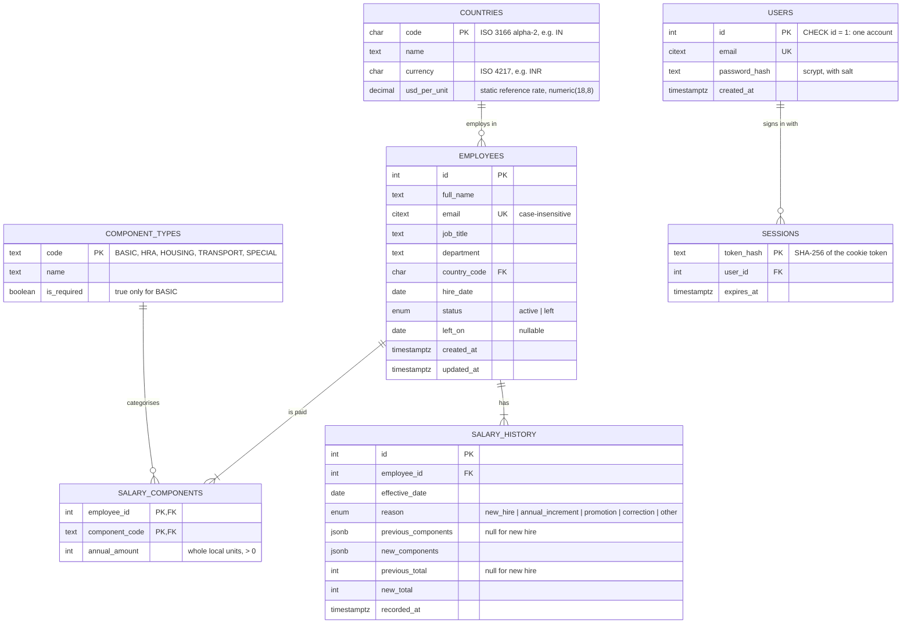

# Plan and design notes

_Written after [REQUIREMENTS.md](REQUIREMENTS.md) and before any application code._

## 1. Tech stack

The role is **Software Craftsperson: Node / React / TypeScript**, so the stack follows it. TypeScript is used end to end in `strict` mode.

| Layer | Choice | Why |
|---|---|---|
| Language | **TypeScript** (frontend and backend) | One language across the stack; types catch whole classes of bugs before tests run |
| Backend runtime | **Node.js 24 (LTS)** | Matches the role |
| Backend framework | **Express 5** | Minimal and well known; v5 forwards errors from async handlers to the error middleware without wrappers |
| Validation | **Zod** | One schema gives runtime validation *and* the static type, shared by the API and tests |
| Database | **PostgreSQL 17** | Production-grade relational database: real `CHECK` constraints, triggers, case-insensitive text (`citext`), `percentile_cont` for medians, concurrent writes. Runs locally with one `docker compose up` |
| Database access | **Prisma** (ORM + migrations) | Typed client generated from one `schema.prisma`, so queries are checked by the compiler; versioned SQL migrations; parameterised queries by default. Features Prisma's schema can't express (`CHECK`, triggers, `citext`) are added as raw SQL inside the migrations |
| Password hashing | **`node:crypto` scrypt** | Built into Node (no native add-on), memory-hard, suitable for passwords |
| Frontend | **React 19** with **functional components and hooks only** | Required by the brief; no class components |
| Build tool | **Vite** | Fast dev server and build; proxies `/api` to Express in development |
| Global state | **Redux Toolkit** | Auth/session state and app-wide UI state (e.g. notifications) in typed slices |
| Server data | **RTK Query** (part of Redux Toolkit) | Keeps API data in the same Redux store: caching, loading/error states, and cache invalidation after edits (e.g. a salary change refreshes the directory, details page and insights) |
| Routing | **React Router** | Directory filters live in the URL so views can be refreshed and shared |
| Component library | **MUI (Material UI)** | Accessible components and a responsive grid; themed to match the look of my previous projects (warm cream background, serif headings, brown/green palette, rounded cards, sidebar + top bar) |
| Charts | **Recharts** | Declarative charts for the insights page |
| Tests | **Vitest**, **Supertest** (HTTP), **React Testing Library**, **MSW** (mock the API at the network boundary in UI tests) | One fast runner for both packages; UI tests exercise real Redux/RTK Query code paths. Backend tests run against a real PostgreSQL test database (Docker locally, a service container in CI), with tables truncated between tests, so constraints and triggers are tested for real rather than mocked |
| Repo layout | **npm workspaces**: `backend/`, `frontend/` | One install, one test command, independent packages |

## 2. Data model



Notes on the model:

- **The schema lives in `backend/prisma/schema.prisma`**; every change is a Prisma migration committed to the repo. Rules Prisma's schema language can't express are added as raw SQL in the migration files: `CHECK` constraints (`annual_amount` between 1 and 100,000,000, `users.id = 1`, `left_on` set if and only if `status = 'left'`, previous components and total null only for `new_hire`), the append-only triggers, the `citext` extension, and the five fixed component types. Foreign keys never cascade deletes to employees, salaries or history.
- **Current salary = the rows in `salary_components`** for an employee; **total = their sum** (computed in SQL, never stored, so it can't drift).
- **Currency is not stored on the employee.** It comes from `countries`, so an employee in India can't be "paid in EUR" by mistake.
- **USD figures are computed** as `ROUND(total × usd_per_unit)`, using the dated rate. The rates date is shown in the UI.
- **Salary history is append-only**: PostgreSQL triggers raise an error on any `UPDATE` or `DELETE` of `salary_history`, so the rule holds even if application code (or someone in a SQL console) gets it wrong. `TRUNCATE` skips row triggers; the application never truncates, and in production its database role should not have the `TRUNCATE` privilege. Old and new components are stored as `jsonb` snapshots, so an entry stays readable even if the component catalogue changes later.
- **Creating an employee writes the first history entry** (`new_hire`), so every employee's history starts at their first salary.
- **Mark as left** sets `status = 'left'` and `left_on`; rows are never deleted. Directory, insights and CSV export only include `active` employees by default.
- **One account** is enforced by `CHECK (id = 1)` on `users`; the seed script creates it from environment variables. There is no sign-up endpoint.
- **Sessions** are stored server-side; the browser holds a random token in an `httpOnly`, `SameSite=Strict` cookie, and only a hash of the token is stored, so a leaked database doesn't leak live sessions.
- **Indexes** (declared in `schema.prisma`): `employees(status, country, job_title)`, `employees(department)`, `employees(full_name)`, `salary_history(employee_id, effective_date)`. Name/email search uses `ILIKE`; a `pg_trgm` index is the next step if search ever gets slow (not needed at 10k).

## 3. Key design decisions and trade-offs

| Decision | Why | Trade-off |
|---|---|---|
| **PostgreSQL** (instead of SQLite, which the brief suggests) | Real constraints, triggers and concurrent writes; the same database in development, tests, CI and production; scales well beyond 10k | Reviewers need Docker (or a Postgres install) to run it; tests are slower than in-memory SQLite and must clean up between cases |
| **Prisma** | Typed queries and versioned migrations from one schema file; injection-safe by default | Can't express `CHECK`/triggers/`citext` in its schema (raw SQL in migrations); aggregates such as median need `$queryRaw`; a generated client and an extra build step |
| **Whole-number amounts** | No floating-point money errors; annual salaries aren't paid in cents | Can't store fractional amounts |
| **Components in their own table** | Breakdown, totals and validation ("Basic is required") are simple queries | Totals need a `SUM` join; covered by indexes |
| **History as JSON snapshots** | An entry is a complete, readable record of before/after | Harder to query *inside* old entries; not needed in v1 |
| **Salary change = one transaction** (update components + append history) | The two can never disagree | None meaningful |
| **Effective date recorded, not scheduled** | Changes apply immediately; the date says when it counts from | No future-dated changes in v1 |
| **Server-side sessions** (not JWT) | Logout really revokes access; simple to test | A session lookup per request (indexed, sub-millisecond) |
| **Soft delete ("left")** | History is never lost | Every query must filter by status; done in one place in the repository |
| **Static exchange rates** | Reproducible reports | Rates need a manual update |
| **Aggregates in PostgreSQL** (`percentile_cont(0.5)` for median, `min`/`avg`/`max`, `GROUP BY`) via `$queryRaw` tagged templates | Only small result rows leave the database; fast at any size | Raw SQL isn't type-checked by Prisma, so results are parsed with Zod and covered by tests with hand-calculated answers |
| **Redux for app state, RTK Query for server data** | Uses Redux as requested without hand-writing loading/caching logic | More setup than plain hooks for a small app |
| **Express serves the built frontend in production** | One deployable service, no CORS | Static files would ideally sit on a CDN |
| **Directory list as one parameterised SQL query** (`$queryRaw`) | Sorting by annual salary needs the component total converted to USD, which Prisma's query builder can't express | Not type-checked by Prisma: results are parsed with Zod; sort columns come from an allow-list and every value is a bound parameter |
| **Offset pagination** (`LIMIT`/`OFFSET`) | "Page 3 of 400" and totals are what HR expects | Slower for very deep pages on huge tables; not an issue at 10k |

## 4. Architecture (backend)

```
http/          Express routes, auth middleware, error handler (Zod validates every input)
  ↓
services/      use cases with logic: salary changes (transaction + history), insights, auth
  ↓
repositories/  all database access through the Prisma client (and $queryRaw for aggregates)
  ↓
prisma/        schema.prisma, migrations (incl. raw SQL for CHECKs and triggers), seed

validators/    business rules: Zod schemas, pure functions and types, used by every layer, depends on nothing
```

`createApp({ prisma, clock })` wires everything together, so tests pass a Prisma client connected to the test database and a fixed clock. Services that change more than one table use `prisma.$transaction`.

## 5. Test-first build order

Each step: write failing tests → make them pass → refactor → commit. Every commit keeps the suite green.

| # | Step | Tests written first |
|---|---|---|
| 0 | **Project setup**: workspaces, TypeScript strict, Vitest, Prettier, `docker-compose.yml` with PostgreSQL (dev + test databases), Prisma installed, CI (GitHub Actions with a Postgres service container) | A trivial test proves the runner works in both packages and that the backend can connect to the test database |
| 1 | **Validators**: component catalogue and salary totals, employee and salary-change validation (Zod), statistics (min/median/mean/max), currency conversion | Pure unit tests, including edge cases (missing Basic, duplicate component, zero or negative amounts, impossible dates, empty lists) |
| 2 | **Database**: `schema.prisma`, first migration with raw-SQL `CHECK`s, append-only triggers and `citext`; test helper that migrates and truncates the test database | Constraint tests against real PostgreSQL: history `UPDATE`/`DELETE` rejected, second user rejected, unknown country rejected, non-positive amount rejected, duplicate email in different case rejected |
| 3 | **Repositories**: employees (search, filters, sort, paging, active only), components, history | Against the test database, including injection attempts in search and sort, and `%`/`_` wildcard escaping in `ILIKE` |
| 4 | **Salary service**: create employee (+ first history entry), change salary (one transaction), mark as left | Rollback when part of a change fails; history written exactly once; no change when nothing differs |
| 5 | **Insights service**: summary, by country, by job title in a country, by department, distribution | Known small data sets with hand-calculated answers; leavers excluded |
| 6 | **Auth**: password hashing, login, logout, session middleware | Wrong password, expired session, missing cookie → 401; every `/api` route except login is protected |
| 7 | **HTTP API**: employees, salary changes, history, insights, CSV export, meta; one error format | Supertest for every endpoint and error path (400 / 401 / 404 / 409) |
| 8 | **Seed** (`prisma db seed`): deterministic generator (seeded random numbers), 10,000 employees with components and history inserted in batches with `createMany`, the HR Manager account | Same seed → same data; every row passes the API's validation; unique emails; runs in under a few seconds |
| 9 | **Frontend foundation**: Vite, MUI theme and responsive layout, Redux store, RTK Query API slice, login page, protected routes | Login form validation; redirect to login when the session is missing |
| 10 | **Directory**: search, filters, sorting and paging in the URL; table ↔ cards; CSV export | URL ↔ query mapping (pure); page renders results via MSW |
| 11 | **Employee details**: breakdown by component, history timeline, edit details, change salary, mark as left | Salary-change form (components, reason, effective date); server errors shown next to fields |
| 12 | **Insights page**: KPIs, pay by job title in a country, by country, by department, distribution | Formatting helpers; sections render with mocked data |
| 13 | **Ship**: production build, Dockerfile (runs `prisma migrate deploy` on start), deploy with a managed PostgreSQL, README, architecture and trade-off docs with measured performance, demo video | Smoke test of the production build |

## 6. Definition of done (every step)

- Tests written first, failing for the right reason, then passing.
- `npm test` and `npm run typecheck` green.
- No requirement contradicted; if scope changes, `REQUIREMENTS.md` is updated first.
- A small commit with a clear message.
